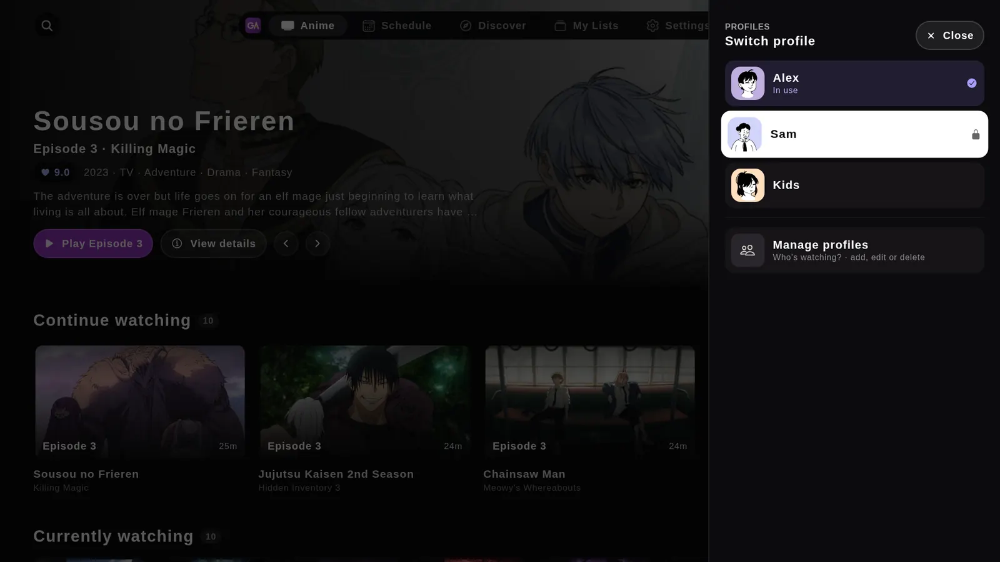
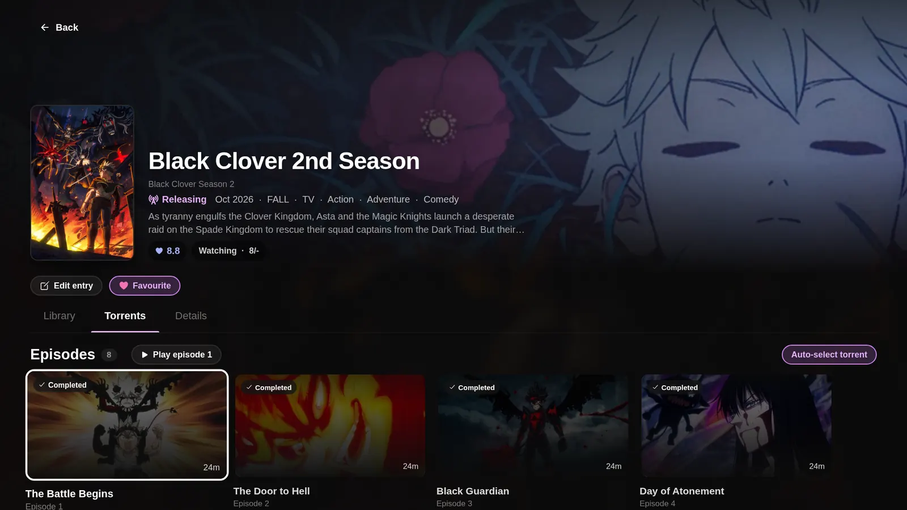
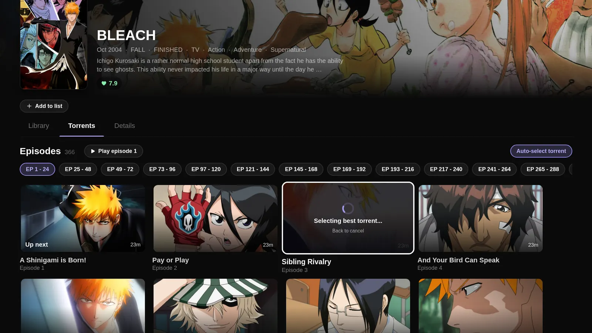
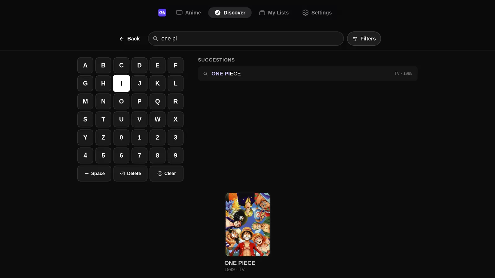

<h1 align="center">Garceslab Anime TV</h1>

The LG webOS TV app for a self-hosted Garceslab Anime server. 
Based on Seanime Tenji and Seanime (GPL-3.0).

---

> **Not original work.** Garceslab Anime TV is derived from
> [Seanime Tenji](https://github.com/AlkindiX/seanime-tv) (© AlkindiX and contributors), itself
> based on Seanime Tenji and [Seanime](https://github.com/5rahim/seanime) (© 5rahim and
> contributors). This code is not our property: their authors keep their copyright, and this
> project only adds modifications, under the same licenses. See
> [Credits & License](#credits--license).

**Status: early development.** The app is tested on an LG TV with **webOS 23**. Other webOS
versions (6.0 and newer) should work but haven't been tried.

This repository is the **TV app**. The server and web interface live in
[garceslab-anime-server](https://github.com/YTvictorworld/garceslab-anime-server). All
documentation is in [`docs/`](docs/README.md).

## What it is

A TV interface for browsing and playing your own Garceslab Anime library with the remote:
D-pad focus, Back, OK, media and colour keys, and the Magic Remote pointer. It is published
only so that people can **self-host a setup that works with LG webOS TVs**.

There is **no hosted service** and no content: the app connects to a server **you** run on
your own network.

> [!IMPORTANT]
> Garceslab Anime does not provide, host or distribute any media content. Users are responsible
> for obtaining media through legal means and for complying with the laws of their country.

## Features

### Profiles: "Who's watching?"

- **"Who's watching?"** on every launch; a PIN keypad (the remote's number keys type too) for
  profiles with a PIN.
- **Create, edit and delete profiles on the TV:** name (on-screen keyboard), avatar from the
  server's free-licensed catalog (CC0 and CC BY 4.0, credits under the grid), optional PIN.
- **Avatar profile switcher** at the end of the nav bar: switch to another profile in two
  presses.
- Each profile has its own **list, progress, settings and player preferences** (languages,
  subtitles, autoplay, skipping, …), kept on the server. AniList is optional: a public list
  can be imported when the profile is created.
- **Favourites** and the **entry editor** on the anime page.

More: [docs/profiles.md](docs/profiles.md).

### Direct play, up to three viewers at once

Debrid (TorBox) streams play **directly** on the TV: the server only hands out the link, and the
TV reads the subtitles from the MKV itself (ASS drawn with libass). That lets **up to three
TVs** watch at the same time. If direct play fails, the TV retries three times with a fresh link
before relaying the stream through the server. More: [docs/direct-play.md](docs/direct-play.md).

The server also picks, among cached releases, one with **subtitles in the profile's language**
(subtitle-aware auto-select).

### Episode tags and Up next

- **CANON / FILLER / RECAP / MIX** pills on episode cards, "Continue watching", the home hero
  and the player (MyAnimeList data through the server).
- **Skip filler and recaps** (player setting, per profile): next episode jumps over them.
- A Netflix-style **Up next** card in the corner near the end of an episode, with the next
  episode's tag and a countdown.

More: [docs/episode-tags.md](docs/episode-tags.md).

### Home, anime page and Schedule

- A **web-like look** in the lilac Garceslab Anime colours: tall banners, card gradients and the
  **Releasing** badge on airing anime; favourites in **My Lists**.
- **Episode cards start playback in place**, with the server's steps ("Selecting best
  torrent…"), *Back to cancel*, and lock and error states.
- A **Schedule** tab: the week as a calendar, with the airing time of every episode in your
  lists.

More: [docs/home-and-schedule.md](docs/home-and-schedule.md).

### Search as you type

The app has **its own on-screen keyboard** (the LG keyboard only hands over text when it
closes), with **suggestions** from the server's local title index: "ble" already suggests
Bleach. More: [docs/remote-and-navigation.md](docs/remote-and-navigation.md).

## Which server it needs

- **[Garceslab Anime](https://github.com/YTvictorworld/garceslab-anime-server)** (recommended,
  needed for profiles, several viewers, tags and suggestions). It also serves streams to the
  TV's native player correctly (requests without an HTTP `Range` header).
- **Seanime v3.10.x** still works for the basics; features its server doesn't offer are
  skipped. Debrid streams on webOS may fail to start with a stock Seanime server because of
  the `Range` issue above.

## Install on an LG TV

1. **Server:** run Garceslab Anime with Docker Compose, as in the server's
   [self-hosting guide](https://github.com/YTvictorworld/garceslab-anime-server/blob/main/docs/self-hosting-webos.md).
2. **TV app:** download the `.ipk` and `SHA256SUMS.txt` from this repository's
   [GitHub Releases](https://github.com/YTvictorworld/garceslab-anime-tv/releases)
   (*coming with 1.0*; until then, build it yourself as in
   [docs/building-webos.md](docs/building-webos.md)), check it with
   `sha256sum -c SHA256SUMS.txt`, and install it with the TV in **Developer Mode** using
   [webOS Dev Manager](https://github.com/webosbrew/dev-manager-desktop) or the webOS CLI
   (`ares-install --device tv garceslab-anime-tv.ipk`). Step by step, and what to do if the
   upload fails: [docs/building-webos.md](docs/building-webos.md#installing-on-the-tv).
3. Open the app and enter your server's address (for example `http://192.0.2.10:43211`) and the
   server password.

The app id is still `app.seanime.tenji` (inherited), so installing Garceslab Anime TV
**replaces** an installed Seanime Tenji instead of adding a second app. A later version will
move to its own id.

## Documentation and development

- [docs/](docs/README.md): every doc, plus the roadmap.
- [CONTRIBUTING.md](CONTRIBUTING.md): issue first, tests and docs in every pull request, the
  "(WIP)" rule, running `npm test`, `npx tsc --noEmit` and `npm run build:webos`.
- [AGENTS.md](AGENTS.md): guide for AI coding agents.
- [webos/README.md](webos/README.md): the full webOS reference (playback, formats, relay
  service, what is not yet verified on a TV).
- [MODIFICATIONS.md](MODIFICATIONS.md): every change compared with Seanime Tenji, with dates.

## Credits & License

Garceslab Anime TV is **not originally our code**. It is derived from:

- **[Seanime Tenji](https://github.com/AlkindiX/seanime-tv)**, © AlkindiX and contributors,
  including its LG webOS port; this repository is derived from its version 0.4.0;
- **[Seanime Tenji](https://github.com/5rahim/seanime-tenji)** and
  **[Seanime](https://github.com/5rahim/seanime)**, © 5rahim and contributors.

Profile avatars are served by the Garceslab Anime server: DiceBear styles under CC0 1.0, plus
**Adventurer** by Lisa Wischofsky under [CC BY 4.0](https://creativecommons.org/licenses/by/4.0/)
([source](https://www.figma.com/community/file/1184595184137881796)); the app shows these
credits under the avatar grid.

Episode tags (CANON / FILLER / RECAP on episode cards) show [MyAnimeList](https://myanimelist.net)
episode data, which the Garceslab Anime server reads through the Jikan-compatible APIs
[Tenrai](https://tenrai.org), [jikan-edge](https://jikan.lucashdo.com) and
[Jikan](https://jikan.moe). The data belongs to MyAnimeList; this project is not affiliated with
MyAnimeList or with these APIs.

Search suggestions come from the server's title index, built from manami-project's
[anime-offline-database](https://github.com/manami-project/anime-offline-database) under the
[Open Database License (ODbL) v1.0](https://opendatacommons.org/licenses/odbl/1-0/).

Anime titles, covers and banners shown in the screenshots come from AniList's public data, as in
Seanime; they belong to their respective owners.

The original authors keep the copyright on their work, and this project does not claim
ownership of it. All original copyright and license notices are preserved unchanged, and the
full git history is kept, so every upstream commit keeps its author.

The modifications made by the Garceslab Anime contributors are distributed under the same
licenses: the [GNU General Public License v3.0](LICENSE) for the app, and the Mozilla Public
License 2.0 for the native modules that use it (listed in [LICENSES.md](LICENSES.md); none has
been modified so far), with no additional restrictions. The modifications and their dates are
listed in [MODIFICATIONS.md](MODIFICATIONS.md); see also [NOTICE](NOTICE).

"Seanime" and "Seanime Tenji", and their logos, belong to their respective owners and are used
only to say where this project comes from. Garceslab Anime is an independent, unofficial
project, not affiliated with or endorsed by Seanime or Seanime Tenji: please don't report
Garceslab Anime issues to them.
