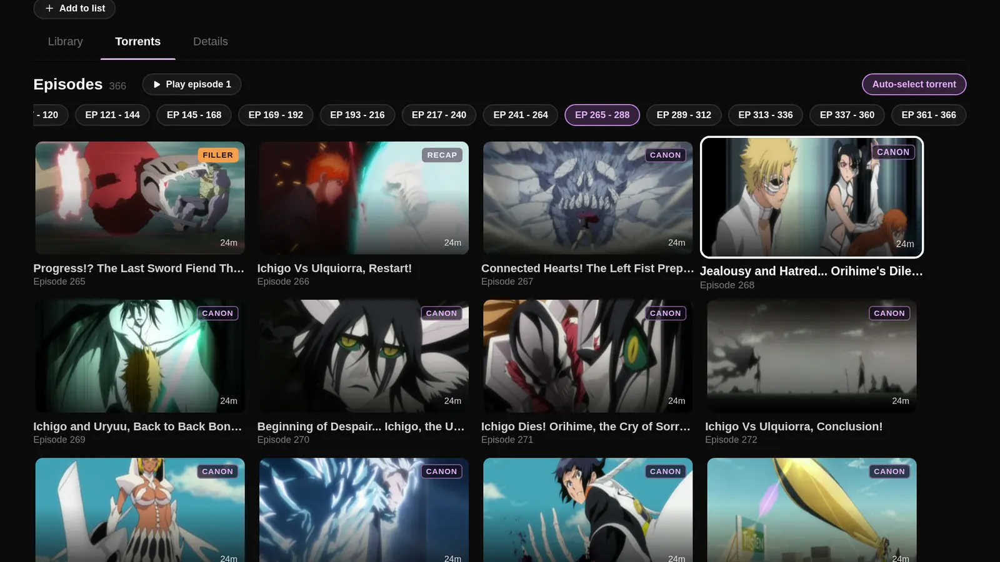
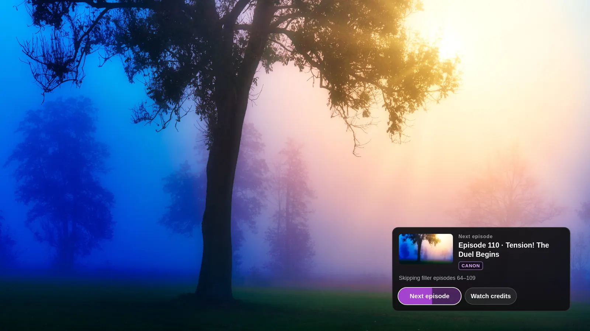

# Episode tags, Skip filler and Up next

## Tags

Episode cards can carry a pill in the top-right corner of the art: **CANON** (muted lilac
outline), **FILLER** (orange), **RECAP** (grey) or **MIX**. They come from MyAnimeList data
through the Garceslab Anime server (`GET /api/v1/anime/episode-tags/{id}`, see the server's
[docs/episode-tags.md](https://github.com/YTvictorworld/garceslab-anime-server/blob/main/docs/episode-tags.md))
and appear only for a show with at least one filler or recap episode.

- Where: the anime page (library, Torrents and online lists), **Continue watching** cards, the
  home hero's continue slide, the player's top bar, its *Next episode* button and the Up next
  card.
- The first visit of a show starts the server's fetch; the pills appear a few seconds later
  (the app asks again every 4 s for about two minutes). Requests are limited to three at a time.
- No data (no MyAnimeList id, an older server, the APIs down) means no pills and no message.
  Specials have no pill. Shows that MyAnimeList and AniList number differently can get shifted
  pills.

## Skip filler and recaps

A player setting (*Settings*, off by default, follows the profile). Auto next and the *Next
episode* button jump over FILLER and RECAP episodes to the next one that isn't, e.g. "Next:
Episode 110 (skipping filler episodes 64–109)". MIX episodes are kept. Without tags, next is the
usual next episode.

## Up next

With *Auto next episode* on, a small card comes up in the **bottom-right corner** while the
episode keeps playing: when the ending starts (from the file's chapters or AniSkip, in the last
three minutes) or in the last 20 seconds. It shows the next episode's art, name and tag, what
*Skip filler and recaps* skips, and a **Next episode** button that fills up over 15 seconds and
then plays it. *Watch credits* (or Back) hides it until the episode ends, when it comes back with
a 10-second countdown; *Cancel* stops it for this episode.

For auto-selected torrent and debrid streams the next episode starts **inside the player**, with
its own loading screen; the old stream ends as the new one starts.

## Code and tests

`src/lib/episode-tags/`, `src/components/tv/tv-episode-tag-pill.tsx`,
`src/components/tv/tv-up-next-card.tsx`. Tests: `tests/episode-tags.test.ts`,
`tests/next-episode-tags.test.ts`, `tests/up-next.test.ts`, `tests/tag-filter.test.ts`.
