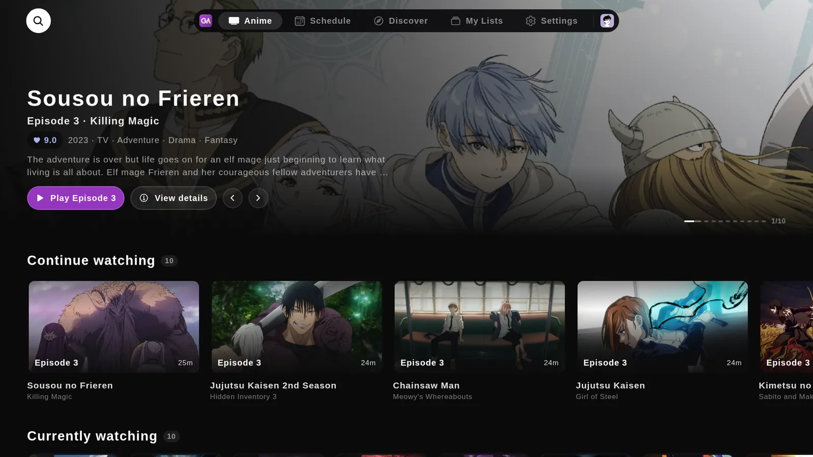
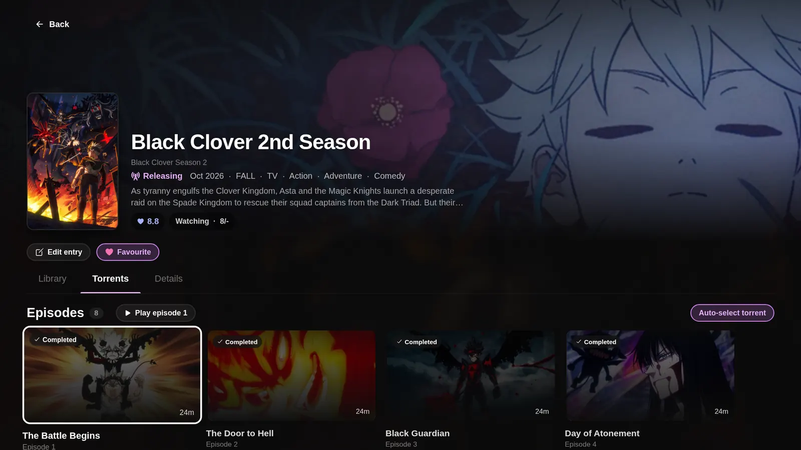
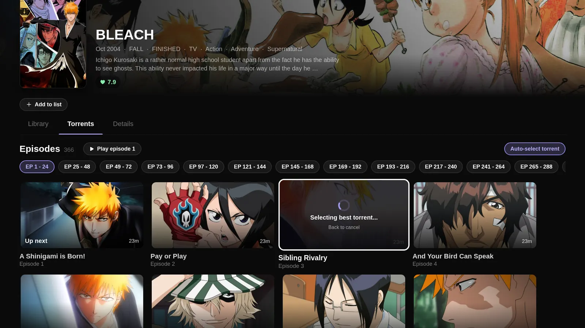
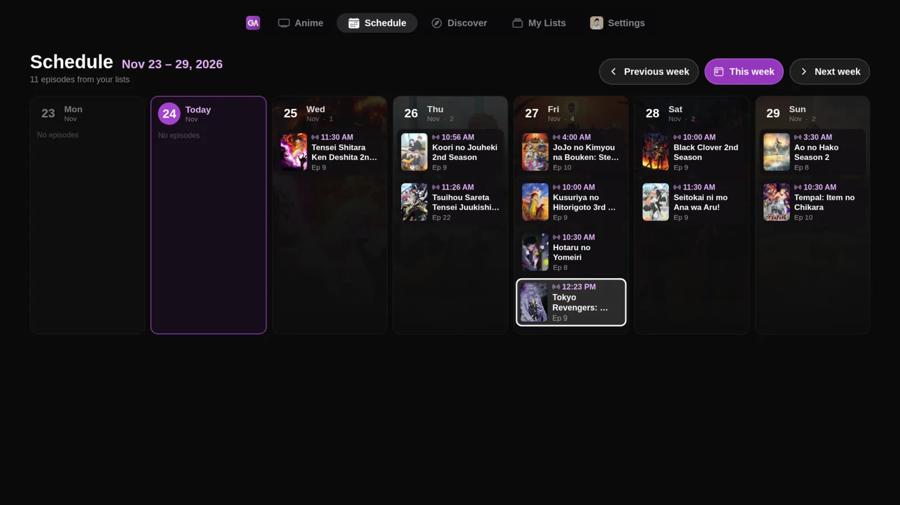

# Home, anime page and Schedule

## Home

- **The hero** starts with the shows to continue watching, then fills up to 8 slides with what
  is trending on AniList. **Continue watching** cards and the hero's *Play*/*Resume* start the
  episode without leaving the home screen.
- **Upcoming** cards at the end of Continue watching for airing shows you're caught up on
  ("Next: Episode 8", the airing time in the TV's time zone and a countdown). When it airs, the
  card turns into a *New episode* card that plays it.
- A **Trending now** row, and the library search as a round **search button** left of the nav
  bar.
- Progress bars and resuming follow one rule: from 10 seconds in up to 90 %.

## Anime page

- A tall banner faded into the page, the **Releasing** badge on airing anime, the *Favourite*
  pill and the entry editor (*Add to list* / *Edit entry*).
- **Episode cards start in place:** OK on an episode in the Torrents tab shows the server's steps
  on that card ("Selecting best torrent…", "Loading…") with *Back to cancel*. While one starts,
  OK on another card says "Episode N is already starting. Press Back to cancel it first." A
  failure turns the card red with the reason (OK tries again).

## Schedule

The nav bar's **Schedule** tab is the web's release calendar as a **week grid**: seven day
columns (Monday to Sunday), today outlined in lilac, each day listing its episodes with a small
cover, the airing time in the TV's time zone, the title, the episode and whether it has aired or
been watched. *Previous week*, *This week* and *Next week* move up to four weeks either way.
Arrows move up and down a day and across days (empty days are skipped); focus starts on the next
episode to air; OK opens the anime and Back returns to the same episode. The list comes from the
server's schedule for the profile.

If the TV's time zone is wrong, build with `EXPO_PUBLIC_TV_TIME_ZONE=<IANA zone>` (a local
option; release builds don't set it).

## Visual refresh

The anime page, cards and rows borrow the web app's look in the lilac Garceslab Anime colours:
ambient backdrop, web-like card gradients, the *Releasing* badge, web-like titles and spacing.
Each effect has its own switch in `src/lib/tv/visual-flags.ts`; turn any of them off for a build
with `EXPO_PUBLIC_TV_VISUAL_OFF=ambientBackdrop,cardGradients npm run build:webos` (`all`
restores the earlier look). None of them uses blur or shadows on cards.

## Code and tests

`src/components/tv/tv-hero-carousel.tsx`, `tv-continue-card.tsx`, `tv-episode-card.tsx`,
`tv-schedule-screen.tsx`. Tests: `tests/tv-home-feed.test.ts`, `tests/tv-upcoming-episodes.test.ts`,
`tests/tv-continue-start.test.ts`, `tests/card-start-race.test.ts`, `tests/tv-schedule-days.test.ts`,
`tests/tv-visual-flags.test.ts`.

`tests/card-start-race.test.ts` renders the old card-start pattern with react-dom's real
scheduler. Its cases don't depend on timing: a check that "waits for a request" answers only
after React has committed the re-render with "preparing" set (a fixed timer raced that render
and lost on a loaded CI runner), and every case also runs with the event loop stalled for 20 ms
after the check is sent.
