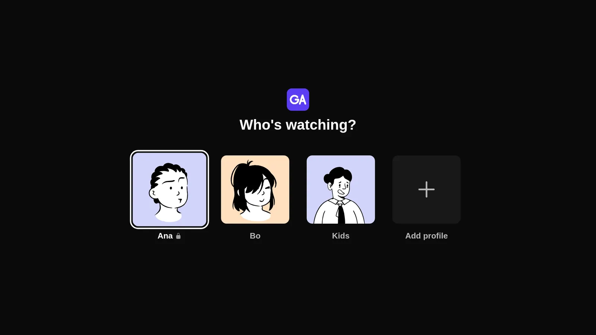
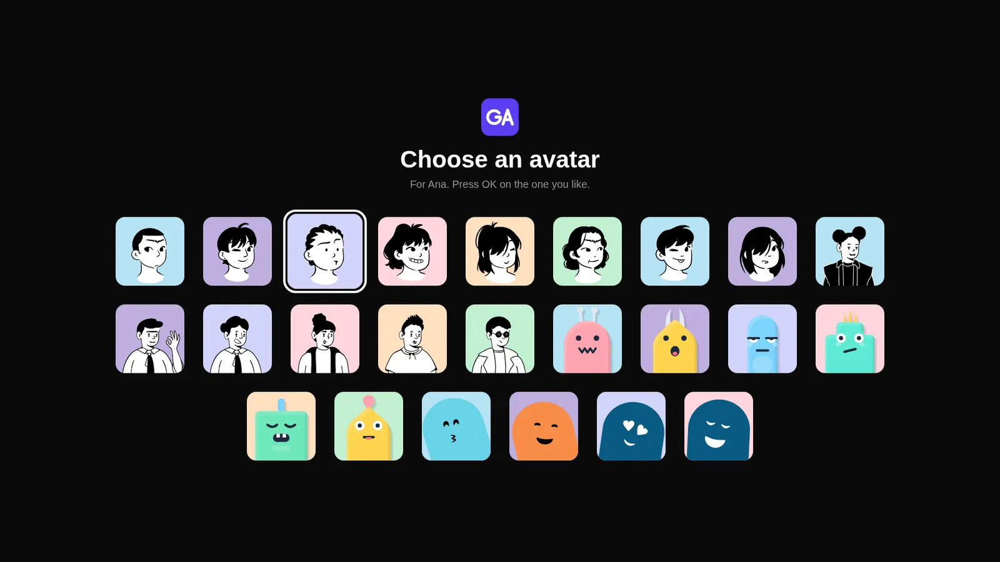
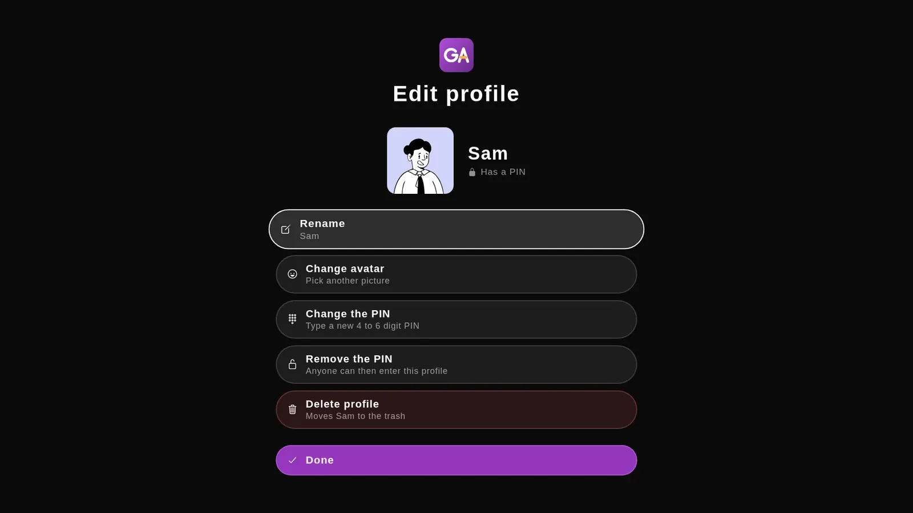
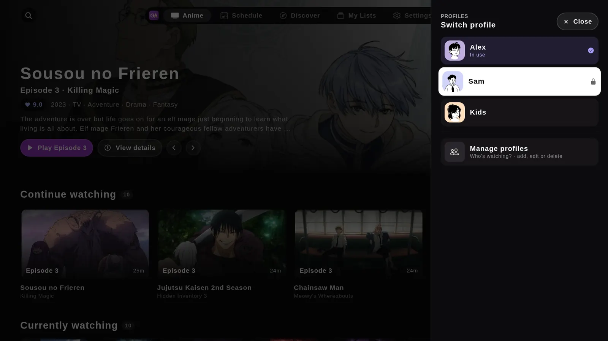

# Profiles on the TV

On a Garceslab Anime server with local profiles, the app asks **"Who's watching?"** on every
cold launch, after the server connection. A stock Seanime server doesn't advertise profiles,
and nothing changes there. How profiles work on the server:
[server docs/profiles.md](https://github.com/YTvictorworld/garceslab-anime-server/blob/main/docs/profiles.md).

## Choosing a profile

- OK on a profile without a PIN enters it. A profile with a PIN opens a numeric keypad; the
  remote's number keys type too. A wrong PIN clears the digits; after five, the server locks
  the profile for a few minutes and the keypad says how long.
- The session token is kept **in memory only**: switching to another app and back keeps the
  profile, closing the app forgets it. If the session ends (PIN changed, profile deleted), the
  app goes back to "Who's watching?".
- Cached screens (the instant start screen) are kept per profile.

## Creating a profile

**Add profile** (or "Create your profile" on a server without profiles): a name typed on the
on-screen keyboard, an avatar from the server's catalog, then an optional PIN and optional
imports (a public AniList list by user name, or the AniList account the server used before
profiles). The avatar grid ends with the licence line and the credits the CC BY 4.0 avatars
need.

## Editing and deleting

The focused profile shows a small **Edit** button under it (press Down). It asks for the
profile's PIN first, if it has one, then lets you rename it, pick another avatar, add, change or
remove the PIN, and **Delete profile**: a confirmation (Cancel focused) explains that it goes to
the server's trash and can be restored from the web for 30 days.

## Switching profiles

The nav bar ends with the **profile's avatar**. OK opens a *Switch profile* drawer with the
other profiles (OK enters one straight away, after its PIN if it has one) and *Manage profiles*,
which goes back to "Who's watching?". Settings also has **Switch profile**.

## What follows the profile

- The list, progress, Continue watching and watch history (kept on the server).
- **Player preferences** (`GET/PATCH /api/v1/profiles/me/player-prefs`, section `tv`): audio
  and subtitle languages, ignored subtitle labels, subtitles on/off and size, ASS rendering,
  autoplay, auto next episode, auto skip, seek steps, speed and *Skip filler and recaps*.
  Entering a profile replaces the TV's values; changes are saved about 1.5 s after the last
  one, only to the profile in use. Device settings (video output, external player, per-file
  delays, stats) stay on the TV. A profile seen for the first time takes this TV's current
  values (the defaults on a new TV: English subtitles); how the subtitle languages are used is
  in [subtitles.md](subtitles.md).
- **Favourites:** the *Favourite* pill on the anime page; *Add to list* / *Edit entry* save to
  the profile's list.

## Code and tests

`src/lib/profile/`, `src/components/tv/tv-profile-*.tsx`, `src/lib/player/player-prefs-sync.ts`.
Tests: `tests/profile-session.test.ts`, `tests/profile-edit.test.ts`,
`tests/player-prefs-sync.test.ts`.
