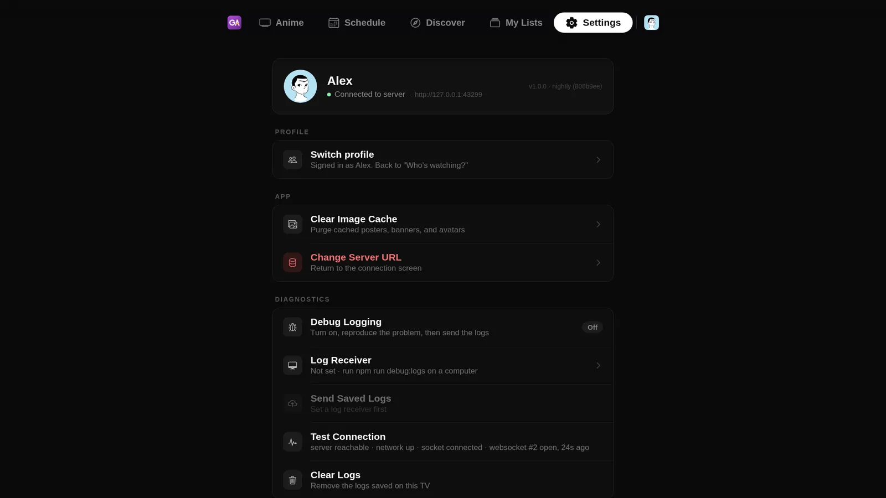

# Releasing

How Garceslab Anime TV is versioned, its two release channels (nightly and stable) and how a
stable release is cut. The server's side, including the
shared rules, is in the server repository's
[docs/releasing.md](https://github.com/YTvictorworld/garceslab-anime-server/blob/main/docs/releasing.md);
both are released together.

## Versions

- Garceslab Anime has its **own version**, starting at **1.0.0**, following
  [semantic versioning](https://semver.org/): `MAJOR.MINOR.PATCH`, no pre-release suffix (webOS
  and Tizen only accept numeric versions).
- Releases are git tags **`vX.Y.Z`**. A tag is never moved or reused: a broken release is
  fixed by a new version.
- **The server and the TV app are released together, with the same version**: TV `v1.0.0`
  goes with server `v1.0.0`, even if only one of them changed.
- The source of the version is **`version` in `package.json`**. The same value must be in
  `package-lock.json` (both `version` fields at the top) and in `app.config.ts`
  (`const version`, shown in Settings as `v1.0.0`). `tests/app-version.test.ts` fails if they
  differ. `webos/build.mjs` writes it into `appinfo.json` and the file name
  (`app.seanime.tenji_1.0.0_all.ipk`); `tizen/build.mjs` writes it into `config.xml`.
- The app id stays **`app.seanime.tenji`**, and 1.0.0 is higher than Seanime Tenji's 0.4.0, so a
  release installs over an existing copy and keeps its settings.
- The in-app "App update available" check compares the app's version with the latest release
  of **this repository** (`src/lib/app-release.ts`).
- The app checks the **server's Seanime version** (`status.version`, 3.10.x), not its
  Garceslab version: it refuses servers below `MIN_SERVER_VERSION` (3.8.0). The server keeps
  reporting Seanime's version there and its own version in `garceslabVersion`.
- `CHANGELOG.md` is Seanime Tenji's changelog up to 0.4.0; Garceslab Anime TV's release notes
  are on [GitHub Releases](https://github.com/YTvictorworld/garceslab-anime-tv/releases).

## Release channels

The TV app has two channels, like the server:

| Channel | What | Where | Settings shows |
|---|---|---|---|
| **nightly** | every push to `main`, built automatically. **It may be broken**: nobody tested it on a TV | the GitHub **pre-release `nightly`** (tag `nightly`, moved to each new build) | `v1.0.0 · nightly (abc1234)` |
| **stable** | a version `vX.Y.Z`, released by the maintainer after the full test on a real TV (below) | the GitHub release `vX.Y.Z`, the repository's **latest** release | `v1.0.0` |

A build made by hand (`npm run build:webos`) is a **dev** build: Settings shows `v1.0.0 · dev`.



- The nightly is never marked as the "latest" release, and its workflow never creates, moves
  or edits a `vX.Y.Z` tag or release. `https://github.com/YTvictorworld/garceslab-anime-tv/releases/latest`
  (and the API's `/releases/latest`) is always the newest stable release.
- The in-app "App update available" notice (`src/lib/app-release-updates.ts`) runs only in a
  **stable** build and offers only the latest stable release. Nightly and dev builds never show
  it (`appUpdateNoticeAllowed` in `src/lib/build-identity.ts`).
- The version stays the numeric `package.json` version in every channel (webOS only accepts
  `x.y.z` in `appinfo.json`), so a nightly and the stable release of the same version have the
  same `.ipk` version; the commit tells them apart.

### Build identity

`webos/build.mjs` reads `GARCESLAB_BUILD_CHANNEL` (`stable`, `nightly` or `dev`; default `dev`)
and `GARCESLAB_BUILD_COMMIT` (the full commit SHA; required for `stable` and `nightly`, taken
from `git` for a dev build), embeds them in the app (Settings, update notice) and writes them to
**`build.json` in the app directory**, next to `appinfo.json`. On the TV it is
`/media/developer/apps/usr/palm/applications/app.seanime.tenji/build.json` (Developer Mode
install), so a tool can read which build is installed:

```json
{
  "version": "1.0.0",
  "channel": "nightly",
  "commit": "<full 40-character SHA>",
  "shortCommit": "abc1234",
  "builtAt": "2026-11-25T12:00:00.000Z"
}
```

`commit` and `shortCommit` are `null` in a dev build made without git. A build older than this
file has no `build.json`: treat it as unknown. `release.yml` builds with `stable`,
`nightly.yml` with `nightly`.

### Nightly assets

The `nightly` pre-release always holds exactly these files of the newest build:

| Asset | Contents |
|---|---|
| `app.seanime.tenji_<version>_all.ipk` | the webOS package |
| `SHA256SUMS.txt` | SHA-256 of the `.ipk`, `build.json` and `changes.json` (`sha256sum -c SHA256SUMS.txt`) |
| `build.json` | the build identity above, plus `previousCommit` |
| `changes.json` | the pull requests merged into `main` since the previous nightly |

`build.json` of the pre-release:

```json
{
  "version": "1.0.0",
  "channel": "nightly",
  "commit": "<full SHA of this build>",
  "shortCommit": "abc1234",
  "builtAt": "2026-11-25T12:00:00.000Z",
  "previousCommit": "<full SHA of the nightly it replaced, or null>"
}
```

`changes.json`, oldest merge first:

```json
[
  { "type": "feat", "title": "Seasons tabs on the anime page", "pr": 21, "url": "https://github.com/YTvictorworld/garceslab-anime-tv/pull/21" },
  { "type": "fix", "title": "Spanish subtitles selected at start", "pr": 22, "url": "https://github.com/YTvictorworld/garceslab-anime-tv/pull/22" },
  { "type": "internal", "title": "nightly pre-release on every push to main", "pr": 23, "url": "https://github.com/YTvictorworld/garceslab-anime-tv/pull/23" }
]
```

- `type` comes from the Conventional Commit prefix of the **pull request title**: `feat` →
  `"feat"`, `fix` → `"fix"`; `docs`, `ci`, `test`, `chore`, `build`, `refactor` and `style` →
  `"internal"` (listed so nothing is lost, but meant to be hidden from TV users); anything
  else (`perf`, `revert`, no prefix) → `"other"`.
- `title` is the PR title without the prefix (`feat(tv): Seasons tabs` → `Seasons tabs`).
- Only pull requests are listed; commits pushed to `main` directly have no entry. The first
  nightly (no previous one), a re-run on the same commit, or a previous commit that no longer
  exists give `[]`.
- Each `changes.json` covers one nightly. When a TV skipped some nightlies, an updater that wants
  all changes since the **installed** commit keeps the `changes.json` files it has seen (following
  `previousCommit` back to the installed commit), or asks GitHub for the PRs itself.

The release notes repeat the non-internal changes and link the exact source commit
(GPL-3.0 §6).

### Following a channel from your own tool

Installing updates automatically is not part of this repository: a self-hoster's own tool does
it, over webOS Developer Mode (as in [building-webos.md](building-webos.md#installing-on-the-tv)).
Such a tool can:

- **Follow nightly:** poll
  `https://github.com/YTvictorworld/garceslab-anime-tv/releases/download/nightly/build.json`;
  when its `commit` differs from the installed one (the TV's `build.json`), download the
  `.ipk` and `SHA256SUMS.txt` from the same `releases/download/nightly/` path and check them.
  If the checksum doesn't match, the nightly is being replaced right now: try again a few
  minutes later.
- **React to the webhook instead of waiting for the next poll:** subscribe to the repository's
  `release` webhook and treat a `release` event for the tag `nightly` with action **`edited`**
  (an existing nightly was replaced) or **`published`** (the first nightly) as "**the nightly is
  complete**": check it right away, as above. Ignore `created` (the first nightly's draft, with
  no assets yet). See [When a nightly is complete](#when-a-nightly-is-complete).
- **Follow stable:** poll `https://api.github.com/repos/YTvictorworld/garceslab-anime-tv/releases/latest`
  (never a pre-release); a newer `tag_name` `vX.Y.Z` has the `.ipk` and `SHA256SUMS.txt` as
  assets.

### When a nightly is complete

GitHub sends the `release` webhook when the release itself changes (its title, notes or flags),
not when an asset is uploaded. So the nightly workflow changes the pre-release in this order,
and the release is edited **last**:

1. Upload the `.ipk` and `changes.json` (`--clobber` replaces the old ones; while that runs, an
   asset can be missing for a moment).
2. Upload `SHA256SUMS.txt`, after the files it lists.
3. Upload `build.json`, last: a poller that sees a new `commit` there finds the matching `.ipk`
   and `SHA256SUMS.txt` already in place.
4. Delete the previous nightly's assets the new build doesn't have (e.g. an `.ipk` of an older
   version).
5. **Edit the release**: title, notes, pre-release and not "latest". This sends the `edited`
   event. The first nightly is created as a **draft** before step 1 (drafts are invisible to
   updaters) and this edit publishes it, which sends `published`.

When `edited` (or `published`) arrives, the release holds exactly the newest build's assets
and its notes describe that build. Between the first upload and that event the assets may be a
mix of the old and the new build: a poller that lands there gets a checksum mismatch and tries
again later. `bash .github/scripts/nightly-check_test.sh` runs the workflow's publish script
against a fake `gh` and fails if this order changes.

## Who and when

- Only the **maintainer** cuts releases.
- Only **after the full TV test**: the `.ipk` built from `main` installed on a real LG TV
  (an LG C3, webOS 23, is the reference) against a server built from the server's `main`, with
  the features in [README.md](README.md) checked (profiles, home, playback with direct play and
  subtitles, episode tags, remote).
- Server first, then the TV app, with the same version.

## Cutting a release

1. **Bump the version** (skip for 1.0.0, which is already set): an issue and a pull request
   that change `package.json`, `package-lock.json` and `app.config.ts`
   (`npm version X.Y.Z --no-git-tag-version` updates the first two), plus the server's
   `GarceslabVersion` in its own pull request. Merge both.
2. Release the server (its doc).
3. **TV app:** GitHub → *Actions* → **Release (webOS .ipk)** → *Run workflow*:
   - *Use workflow from*: **`main`**
   - *version*: the version without `v`, e.g. **`1.0.0`**
   - *confirm*: **`publish`**

   Or from a terminal:

   ```sh
   gh workflow run release.yml -R YTvictorworld/garceslab-anime-tv --ref main \
     -f version=1.0.0 -f confirm=publish
   gh run watch -R YTvictorworld/garceslab-anime-tv
   ```
4. **Verify** (below).

Pushing a tag by hand (`git tag v1.0.0 && git push garceslab v1.0.0`) still starts the same
workflow; it fails if the tag doesn't match `package.json`. The *Run workflow* way is preferred
because it checks everything **before** a tag exists.

## What the workflow does

[`.github/workflows/release.yml`](../.github/workflows/release.yml), job by job:

1. **Check the request** (read-only): runs the tests of the release rules, then
   [`.github/scripts/release-check.sh`](../.github/scripts/release-check.sh). It **fails with
   a message** (an error annotation on the run) when *confirm* is not exactly `publish`; when it
   runs on a branch other than `main` or a tag that isn't `vX.Y.Z`; when, from `main`, *version*
   is empty, isn't `MAJOR.MINOR.PATCH` or its tag already exists; and when the version isn't the
   one in `package.json`. Nothing is built or published then.
2. **Tests and webOS .ipk** (read-only token): `npm ci`, `npm test` and `npm run build:webos`
   on the exact commit the run started on, checks that `app.seanime.tenji_X.Y.Z_all.ipk` was
   produced and writes `SHA256SUMS.txt`.
3. **Tag and GitHub Release** (`contents: write`): checks the checksums of the built files,
   creates the tag `vX.Y.Z` at that commit (when run from `main`; only now, so a failed build
   leaves no tag), and creates the GitHub Release with the `.ipk` and `SHA256SUMS.txt`. Its notes
   link the matching server release, the exact source tree and commit (GPL-3.0 §6), `NOTICE` and
   `MODIFICATIONS.md`.

Only one release runs at a time (`concurrency: release`). A tag created by the workflow doesn't
start the workflow a second time (GitHub doesn't trigger workflows from its own token's
pushes).

If a run fails after the tag was created (e.g. at the release step), run the workflow again on
the tag (*Use workflow from* = `vX.Y.Z`, *confirm* = `publish`).

## Verifying a release

```sh
gh release download v1.0.0 -R YTvictorworld/garceslab-anime-tv -D /tmp/ga-tv-1.0.0
cd /tmp/ga-tv-1.0.0 && sha256sum -c SHA256SUMS.txt     # app.seanime.tenji_1.0.0_all.ipk: OK
git ls-remote --tags https://github.com/YTvictorworld/garceslab-anime-tv v1.0.0
```

- Install the downloaded `.ipk` on the TV ([building-webos.md](building-webos.md#installing-on-the-tv)):
  Settings shows **v1.0.0** (no channel: it is a stable build), and the app connects to the server of the same version.
- The release page lists the `.ipk`, `SHA256SUMS.txt`, the source link and the commit.

## Rolling back

Tags and releases stay; roll back by installing the previous version and fixing forward.

- **On a TV:** download the previous release's `.ipk` and install it. webOS may refuse a lower
  version over a higher one; then remove the app first
  (`ares-install --device tv --remove app.seanime.tenji`, or long-press it in the launcher) and
  install the older `.ipk`. Removing the app clears its saved server address and settings on
  the TV (the server keeps profiles and progress).
- **The broken release:** edit its notes to say "Don't use: see vX.Y.Z+1" (or mark it as a
  pre-release so it isn't "latest" and the in-app update check stops offering it), fix it in a
  pull request, bump the PATCH version in both repositories and release again.
- **A tag created by mistake with no release:** `git push --delete garceslab vX.Y.Z`, then run
  the workflow from `main` again.

## The nightly workflow

[`.github/workflows/nightly.yml`](../.github/workflows/nightly.yml) runs on **every push to
`main`** only (not on pull requests, tags or by hand). A newer push cancels an older run that is
still going.

1. **Tests and nightly .ipk** (read-only token): runs the tests of the nightly rules, then
   [`.github/scripts/nightly-check.sh`](../.github/scripts/nightly-check.sh), which **fails with
   a message** for anything but a push to `main`; then `npm ci`, `npm test` and
   `npm run build:webos` with `GARCESLAB_BUILD_CHANNEL=nightly` and the commit.
2. **Nightly pre-release** (`contents: write`): checks that the built commit is still `main`'s
   head (so re-running an old run never moves the nightly back), writes `build.json`,
   `changes.json` (from the GitHub API, by
   [`.github/scripts/nightly-release.mjs`](../.github/scripts/nightly-release.mjs)) and
   `SHA256SUMS.txt`, moves the `nightly` tag to the built commit (only now, after a successful
   build), then updates the `nightly` pre-release: new assets replace the old ones, assets the
   new build doesn't have are deleted, and only then are its title and notes edited (so the
   `edited` webhook means the nightly is complete, see
   [When a nightly is complete](#when-a-nightly-is-complete)); it stays a pre-release that is
   not "latest".

Nothing needs configuring: it uses the workflow's own token. A failed build leaves the previous
nightly as it was.

## Tests

- `bash .github/scripts/nightly-check_test.sh`: the nightly rules (a push to `main` publishes; a
  pull request, a tag, a manual run or another branch is refused with a message; an old run
  can't move the nightly back) and checks on `nightly.yml` (triggers, pre-release, never
  "latest", no `vX.Y.Z`, and the publish order: assets first, the release edit last, for an
  existing and a first nightly). CI runs it in the *Tests and webOS .ipk* job.
- `tests/nightly-release.test.ts`: how PR titles are classified and aggregated into
  `changes.json`, and the pre-release's `build.json`.
- `tests/build-identity.test.ts`: the version line in Settings per channel, the update-notice
  rule per channel, and how the build resolves and embeds the identity.
- `bash .github/scripts/release-check_test.sh`: the release rules (pass and fail cases, including
  the regression "run from main without *confirm* fails with a message"). CI runs it in the
  *Tests and webOS .ipk* job; the release workflow runs it before every release.
- `tests/app-version.test.ts` (`npm test`): the version is the same everywhere, the app id is
  unchanged, the update check uses this repository and the minimum server version is still a
  Seanime 3.x version.
- CI also checks that `npm run build:webos` produces `app.seanime.tenji_<package.json version>_all.ipk`.
