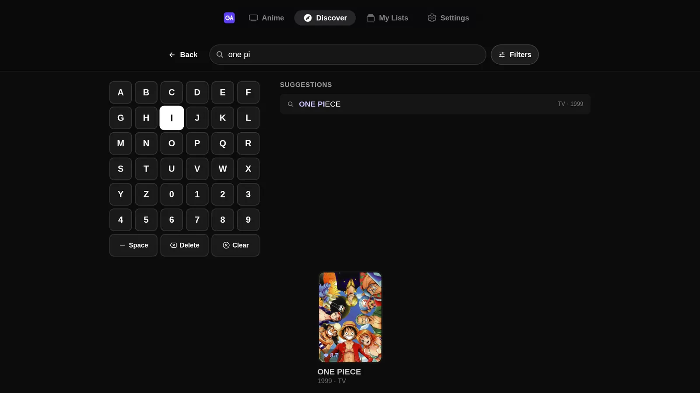

# Remote, navigation and search

The arrow keys, OK and Back work as on Android TV: a D-pad focus engine moves between
controls, and lists glide to the focused card.

## LG remote keys

| Key | In the player | Elsewhere |
| --- | --- | --- |
| Red | Audio & subtitles (press again to close) | |
| Green | Episodes | |
| Yellow | Skip the intro or outro when offered, otherwise show the controls | |
| Blue | Settings | |
| Info | Show or hide playback stats | |
| Stop | Leave the player and end the stream (Back keeps it running) | |
| CH+ / CH- | Next / previous episode | Page up / down through a list or grid |
| 0 to 9 | Jump to 0 %, 10 % … 90 % of the episode | Type into a text field or PIN keypad |
| Play, Pause, ⏩, ⏪ | Play, pause, move the seek target | |

## Magic Remote

- Moving the pointer shows the player controls; clicking the video pauses or plays; clicking or
  dragging the timeline seeks.
- Press the wheel (OK) on a row and move the pointer to drag it; the wheel scrolls the page
  (then rows that only scroll sideways).
- Focus follows the pointer; when it hides, the D-pad highlight comes back.

Back on the first screen shows the system's exit popup.

## On-screen keyboard and search

The LG system keyboard hands its text to the page only when it closes, so the app has **its own
keyboard**: a letter grid for the remote (A–Z, 0–9, Space, Delete, Clear). It is used for
Discover › Search, the library search, profile names and PINs. A keyboard plugged into the TV
types too.

In **Discover › Search**, suggestions appear next to the keyboard and results below, updating as
you type (250 ms after the last key, from two letters on). Suggestions come from the server's
title index (`GET /api/v1/search/suggest`), which matches the start of any title or synonym:
"ble" already suggests Bleach, and the line under a suggestion shows the synonym that matched.
OK on a suggestion opens the anime. The results grid is AniList's search, which matches whole
words. Without the index (older server, turned off), suggestions fall back to AniList.

The library search (the round button left of the nav bar) searches the profile's own lists.

## Not yet verified on a TV

Some remote behaviour has only been checked in desktop Chromium (CH+/CH- delivery, OK in
pointer mode, wheel step sizes). The list is in
[webos/README.md](../webos/README.md#not-yet-verified-on-a-tv).

## Code and tests

`src/lib/webos/spatial-navigation.ts`, `remote.ts`, `remote-input.ts`,
`src/components/tv/tv-on-screen-keyboard.tsx`, `tv-search-screen.tsx`. Tests:
`tests/webos-remote-input.test.ts`, `tests/tv-keyboard.test.ts`, `tests/search-suggestions.test.ts`,
`tests/key-batcher.test.ts`.
