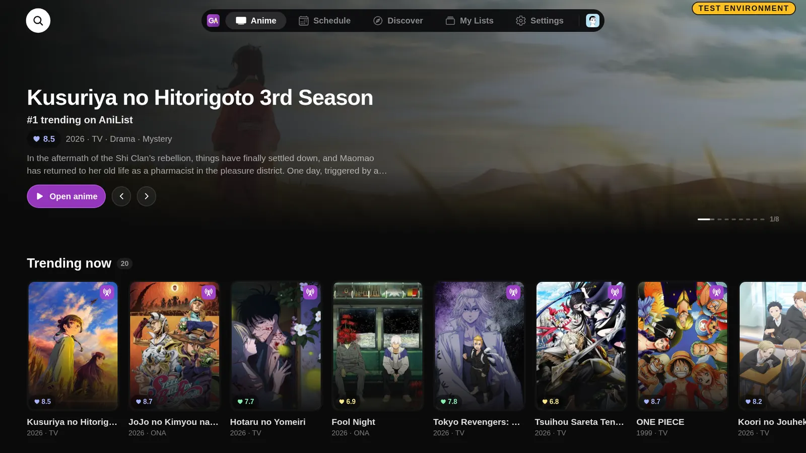
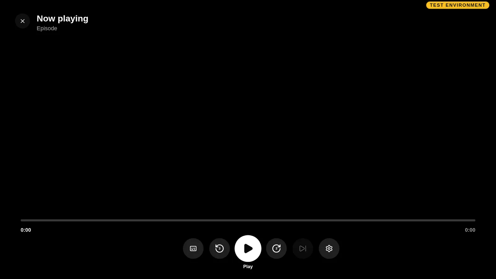
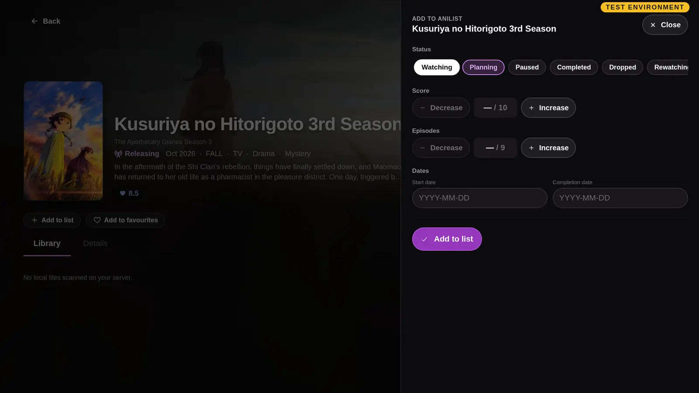

# Testing on a real TV

Desktop Chromium at 1920×1080 is good for layout and screenshots, but it is not a TV: D-pad
focus, the Magic Remote, Back, the player, codecs and subtitles behave differently on an LG
webOS TV, and the TV is much slower. So every pull request that **changes UI behaviour**
(anything the TV user sees or does: layout, focus and remote navigation, Back, the player,
playback, subtitles) is tested on a real **LG webOS TV** before it is merged. Screenshots alone
aren't enough for focus, remote or player behaviour.

## The labels

| Label | Meaning |
|---|---|
| `needs-tv-test` | Changes UI behaviour; must be tested on a real LG webOS TV before merging |
| `tv-tested` | Tested on a real LG webOS TV by a maintainer |

## If you have no TV

1. Say so in the PR and add the `needs-tv-test` label.
2. In the template, tick *"Not tested on a real TV"* and write "n/a" on *"Tested on a real LG
   webOS TV"*.
3. Mention the maintainer, @YTvictorworld (currently the only one who can test on a TV), in the
   PR description and ask for a TV test. Under *"Real-TV test"*, list what to check: the steps,
   the screens and the expected result, using the checklist below. The template writes the handle in backticks so that opening a PR doesn't notify anyone; remove the backticks to send the mention.

AI agents without access to a TV always do this for a UI behaviour change.

The PR can be **ready for review** with `needs-tv-test` (no `(WIP)` needed), but it **can't be
merged**: the *PR ready (WIP rule)* check fails with *"Waiting for a real-TV test: remove
needs-tv-test after testing"* until the label is gone, and adding or removing a label re-runs
it. A ticked *"Not tested on a real TV"* without the label fails the check too.

## The GA Test app

A PR with `needs-tv-test` is tested on the TV in the **GA Test** app (app id
`app.garceslab.anime.test`), a [side-by-side test build](building-webos.md#side-by-side-test-build)
that installs next to the everyday app instead of replacing it. **Never install a PR build over
the main app** (`app.seanime.tenji`): that one follows the nightly channel and is kept up to date
by the self-hosted updater. Every PR uses the same GA Test id, so installing the next one simply
replaces the previous test build and test apps don't pile up on the TV.

CI builds it for you: the **GA Test build** workflow
([`.github/workflows/ga-test.yml`](../.github/workflows/ga-test.yml)) runs for every pull
request labelled `needs-tv-test`, when the label is added and on every new push, and uploads a
workflow artifact named **`ga-test-pr<N>-<sha7>`** (PR number and the first 7 characters of the
PR's head commit) with the `.ipk` and its `SHA256SUMS.txt`. The run's summary page shows the
exact commands. For a PR from this repository the workflow also posts (and keeps updating) one
comment on the PR with the link; PRs from forks get a read-only token, so for them open the
run page instead (*Checks › GA Test build › Summary*). Other labels don't rebuild it, and the
artifact is kept for the repository's artifact retention period (90 days by default).

Download and install it (the [webOS CLI](building-webos.md#installing-on-the-tv)):

```sh
# the latest GA Test run of PR 27 (or take the run id from its "GA Test build" check)
run=$(gh run list -R YTvictorworld/garceslab-anime-tv --workflow ga-test.yml \
  --branch <pr-branch> --limit 1 --json databaseId --jq '.[0].databaseId')
gh run download "$run" -R YTvictorworld/garceslab-anime-tv -n ga-test-pr27-<sha7> -D ga-test
(cd ga-test && sha256sum -c SHA256SUMS.txt)
ares-install --device tv ga-test/app.garceslab.anime.test_*.ipk
ares-launch --device tv app.garceslab.anime.test
```

Check that the artifact's `<sha7>` is the PR's latest commit; Settings in GA Test shows the
same short commit (`dev (<sha7>)`). To build it yourself instead:
`WEBOS_APP_ID=app.garceslab.anime.test WEBOS_APP_TITLE="GA Test" npm run build:webos`.

### The TEST ENVIRONMENT tag

GA Test shows an amber **TEST ENVIRONMENT** tag in the **top right corner** of every screen:
the tabs, anime pages, Settings, the player, "Who's watching", the server setup, error screens,
drawers and dialogs. If you don't see it, you are in the main app. The main app (nightly and
stable), other side-by-side builds, the Tizen build and `npm run dev:webos` never show it.



| In the player | Over a drawer |
|---|---|
|  |  |

- **Decided at build time** from the app id: `webos/build.mjs` (via `webos/app-id.mjs`) tells
  the app its id only for a side-by-side build (`EXPO_PUBLIC_WEBOS_APP_ID`), and only the GA
  Test id shows the tag (`src/lib/test-environment.ts`). Nothing at runtime turns it on or
  off. To see it in the dev server, start it with
  `EXPO_PUBLIC_WEBOS_APP_ID=app.garceslab.anime.test npm run dev:webos`.
- **Out of the way:** it sits in the top 36 px of the screen at the right edge, right of the
  centred nav bar and its profile picture, away from the search button and the player's Leave
  button (top left), and above the update banner (top right, under the nav bar), the player's
  title and the drawers' content. It is drawn over everything, video and dialogs
  included, takes no D-pad focus, lets the Magic Remote pointer and wheel through, moves no
  layout, and is a single static element (no animation or timer).
- **Room for more badges:** it lives in a small container (`#ga-environment-badges`);
  `addEnvironmentBadge()` adds GA Test-only badges to its left, such as the "DEBUG" badge
  planned for debug mode (#30).

On the TV, check that the tag is there and readable from the sofa on a few screens, including
the player while a video plays and with a drawer open, and that it never takes focus.

Good to know:

- **GA Test keeps its own local data.** It has its own saved server URL, password and profile
  (and its own relay service), separate from the main app. Set them once; installing a newer
  GA Test build keeps them. Remove it with `ares-install --device tv --remove
  app.garceslab.anime.test` when you want a clean start.
- **The update card's Install button acts on the main app.** In GA Test the update card talks
  to the same self-hosted updater, which updates `app.seanime.tenji`, not GA Test. That's
  expected; GA Test itself is only ever replaced by the next GA Test build.

## Testing it on the TV

Install the PR's GA Test build ([above](#the-ga-test-app)). Then check what the PR touches:

- **Remote navigation and focus:** arrows reach every control of the changed screen, nothing is
  unreachable or skipped, focus is always visible, lists scroll to the focused card, focus lands
  in a sensible place when the screen opens and after closing a panel. Magic Remote: pointer,
  click, wheel and drag ([remote-and-navigation.md](remote-and-navigation.md)).
- **Back:** closes the open panel or keyboard first, then goes to the previous screen; on the
  first screen it shows the system's exit popup.
- **Player:** starts, pauses, seeks (arrows, ⏩/⏪, numbers), next/previous episode, the colour
  keys, leaving with Back and with Stop, coming back after Home.
- **Subtitles and audio:** the expected track is selected at start, switching tracks works, ASS
  styles and positions look right, timing is in sync.
- **Performance:** turn on **Playback stats** (Info key) and check the mode (direct play or
  transcode) and why; scrolling and focus moves stay smooth, with no stutter or dropped frames
  while playing.
- **Layout:** nothing cut off at the TV's edges, text readable from the sofa.

## Reporting the result

Whoever tests on the TV comments on the PR: the **device and webOS version** (e.g. LG C3,
webOS 23), **what was checked** and how it went, with photos or videos if useful (no private
data in them). Then they **replace `needs-tv-test` with `tv-tested`**, and the check passes once
everything else is green. If something is wrong, they leave `needs-tv-test` and describe the
problem.
