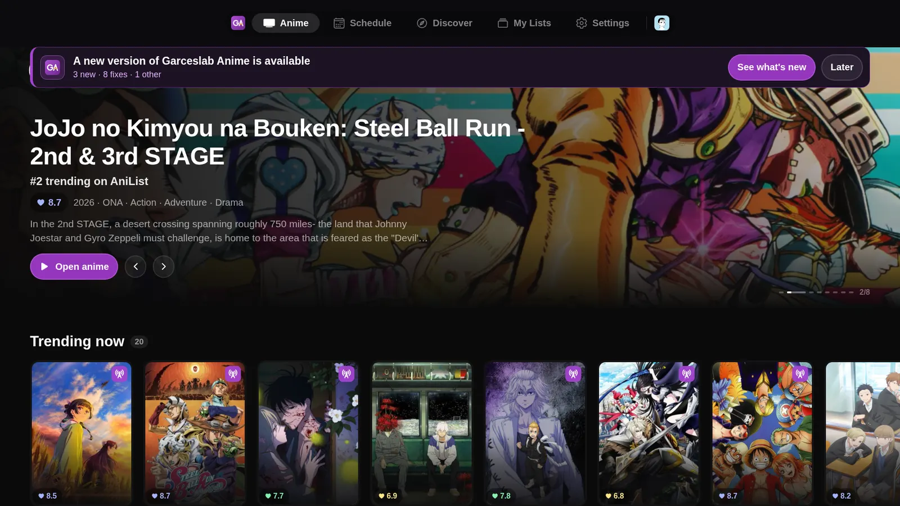
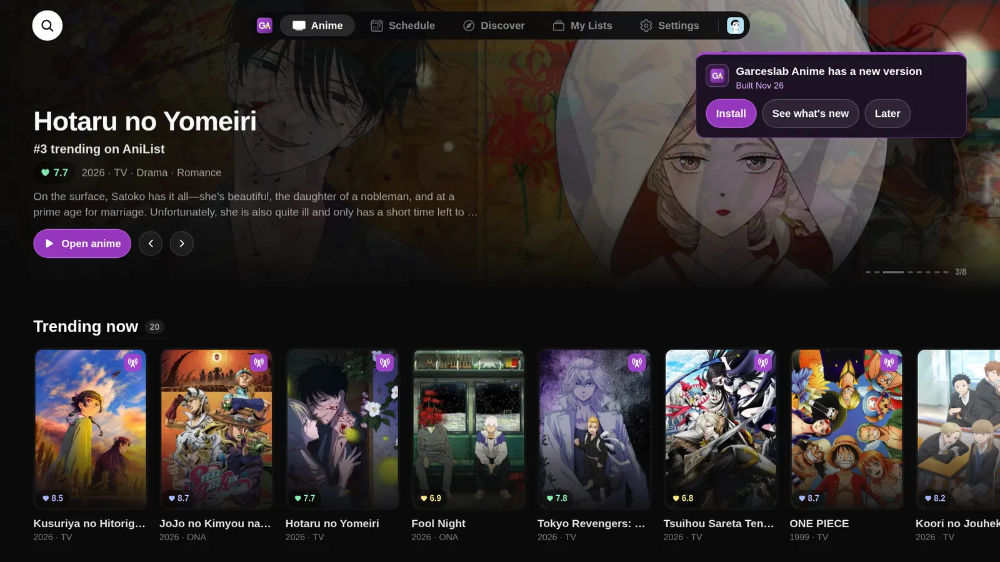
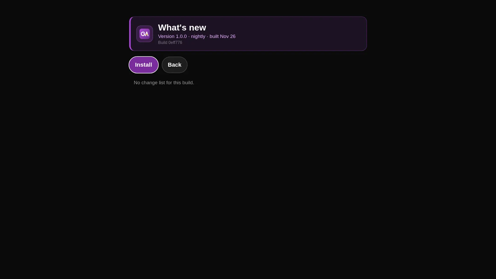
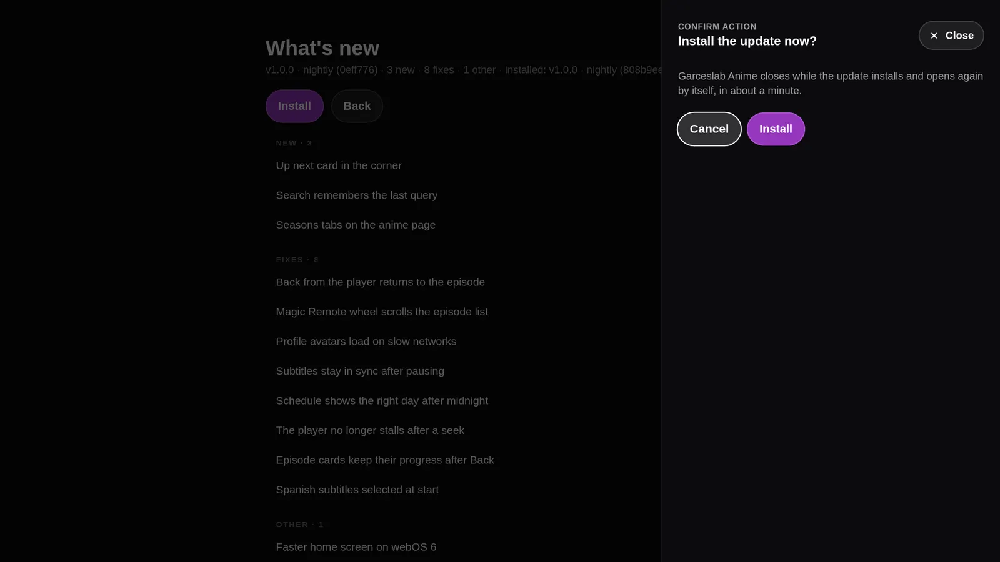
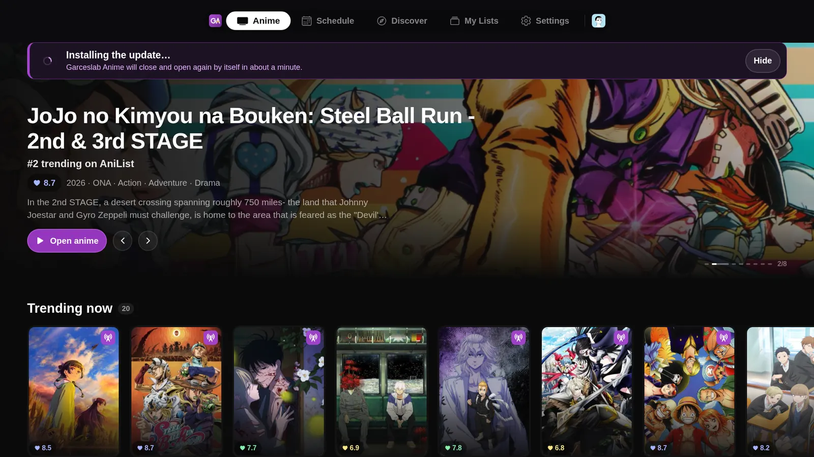
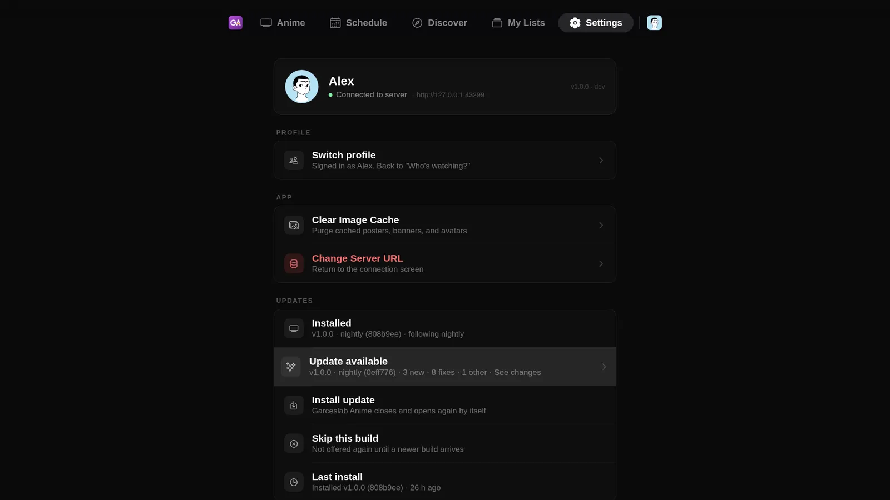
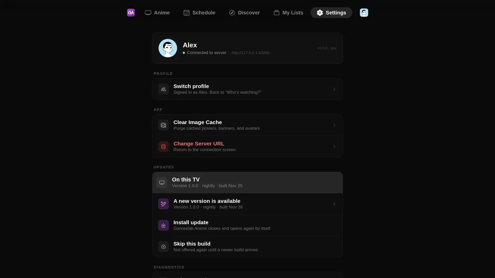
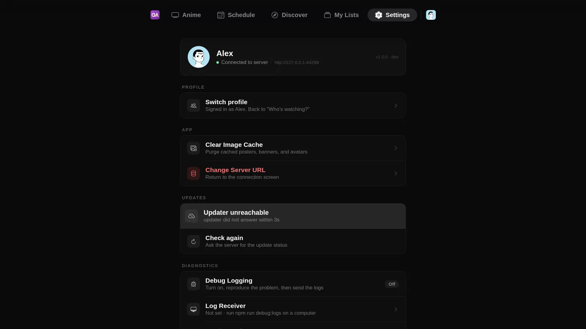

# TV updates: confirm before installing

A new build of the TV app is installed only after someone on the TV says yes. The
self-hoster's own **updater** (outside this repository, over webOS Developer Mode) follows a
release channel, downloads and checks new builds, and waits. The Garceslab Anime server
proxies the updater's status, and the TV shows a banner; nothing is installed until someone
confirms Install.

The TV never talks to the updater: it only calls the Garceslab server
([garceslab-anime-server#18](https://github.com/YTvictorworld/garceslab-anime-server/issues/18)).
When the server has no updater configured, the TV shows **no update UI at all**.

Only the LG webOS build shows any of this (the updater installs over webOS Developer Mode);
the Samsung Tizen build and the native apps don't.

## What you see

Everything sizes to its content: a line, row or group with no data is left out, never shown
empty. The first nightly an updater sees comes without a change list, so that case is part of
the design, not an error.

### The update banner

A slim banner directly under the navigation bar, across the content width, in the app's lilac
with the GA mark. It **pushes the screen down** instead of covering the hero or a row of
posters.

```
[GA]  A new version of Garceslab Anime is available        [ See what's new ]  [ Later ]
      3 new · 8 fixes
```

| With a change list | Without a change list |
|---|---|
|  |  |

- **Second line:** the counts ("3 new · 8 fixes") when the updater listed the changes; without a
  list, just the build date ("Built Nov 27"); without a date either, no second line at all.
  The commit hash isn't shown here (it is in See what's new and Settings).
- **Once per pending build:** it comes in a few seconds after the app opens (or after the
  server reports a new build), only on a tab screen (Anime, Schedule, Discover, My Lists,
  Settings) and only after the remote was idle for about 2.5 seconds, so the screen doesn't
  move while you're going through a row. This TV then remembers the build; the banner stays
  until you close it or leave the app, and doesn't come back for that build.
- **Never during playback** and never on a page opened over the tabs (the player, an anime).
- **Doesn't take focus.** Down from the navigation bar or Up from the top of the screen lands
  on **See what's new** (the whole banner is one focus region); Left/Right move between its
  buttons. **Later**, or **Back** while it has focus, hides it on this TV and moves focus down
  to the screen; the build is still in Settings → Updates.
- **See what's new** opens the list of changes, which has the Install button. The banner has no
  Install button of its own.

### See what's new

A full-screen page with the GA mark, "What's new", the version, channel and build date, the
counts, and the commit in small print ("Build 0eff776, replaces 808b9ee"). **Install** and
**Back** come next, then the changes grouped **New**, **Fixes** and **Other** (newest first);
only the groups that have changes are shown. The D-pad moves line by line and the page scrolls
with it. A build without a change list shows just "No change list for this build." under the
buttons. If the updater couldn't follow every build back to the installed one, a line says some
changes may be missing.

| With a change list | Without a change list |
|---|---|
|  |  |

### Install

**Install** (in See what's new or Settings) first asks to confirm: the app closes while the
update installs and opens again by itself. Then the banner (on the tab screens) and See what's
new say **"Installing the update… Garceslab Anime will close and open again by itself"**. The
updater reinstalls the app and relaunches it, so the app disappearing mid-way is expected:
losing the server during this state is not treated as an error.

- If the updater reports a failure, the banner says **"The update wasn't installed"** with its
  error and offers **Try again**.
- If the install finished but the app wasn't relaunched, the banner asks you to close and open
  the app again.
- The server refuses to install while something is playing on this TV (`409
  PLAYBACK_ACTIVE`); the app says so.

| Confirm | Installing |
|---|---|
|  |  |

### Settings → Updates

Shown only when the server has an updater configured, and only with the rows that have data:

| Row | When | What it shows |
|---|---|---|
| On this TV | the updater knows the installed build | Version, channel, build date and commit |
| A new version is available | a build is pending | Version, channel, date and the counts (when listed); opens See what's new |
| Up to date | nothing pending | The channel the updater follows |
| Install update | a build is pending, or an install runs | Asks to confirm, then installs ("Installing…" while it runs) |
| Skip this build | a build is pending, no install running | Tells the updater to drop this build (`POST /later`); it isn't offered again until a newer one arrives |
| Last install | after the first install | "Installed v1.0.0 (abc1234) · 2 h ago" or "Failed: …" |

When the server can't reach the updater, the section shows **"Updater unreachable"** with the
server's error and a **Check again** row; no banner is shown.

| Update available | Unknown installed build, no install yet | Updater unreachable |
|---|---|---|
|  |  |  |

The screenshots were taken in headless Chromium at 1920×1080 against a throwaway local server
with made-up profiles and a faked updater status.

## How often the TV asks

- When the app starts, when it comes back to the foreground (if the last answer is more than
  5 minutes old), when Settings is opened, and every **30 minutes**. One small request each time.
- Every **5 seconds** only while an install runs, to notice when it ends.
- Nothing while the app is in the background.

## Server API the TV uses

All under the server's normal API envelope (`{ "data": … }`, errors as `{ "error": "…" }`),
sent like every other request (password header, profile session).

| Request | Answer (`data`) |
|---|---|
| `GET /api/v1/tv-updates/status` | `{ "configured": false }` → no update UI. `{ "configured": true, "reachable": false, "error": "…" }` → "Updater unreachable" in Settings. `{ "configured": true, "reachable": true, "status": <updater status> }` |
| `POST /api/v1/tv-updates/install` | `{ "ok": true, "result": … }`, or `ok: false` with `result.error`. `409` with `PLAYBACK_ACTIVE` while this TV plays something |
| `POST /api/v1/tv-updates/later` | Same shape |

A server without these routes (`404`) counts as "not configured".

`<updater status>` is the updater's own `GET /status`, passed through:

```json
{
  "channel": "nightly",
  "installed": { "version": "1.0.0", "commit": "<sha>", "shortCommit": "808b9ee", "channel": "nightly", "builtAt": "…" },
  "pending": {
    "version": "1.0.0", "commit": "<sha>", "shortCommit": "0eff776", "builtAt": "…", "channel": "nightly",
    "changes": [ { "type": "feat", "title": "Seasons tabs", "pr": 21, "url": "…" } ],
    "changesComplete": true
  },
  "tvOnline": true,
  "installing": false,
  "installPhase": null,
  "lastResult": { "at": "…", "ok": true, "version": "1.0.0", "commit": "<sha>", "shortCommit": "808b9ee", "error": null }
}
```

The TV reads it defensively: `installed`, `pending` and `lastResult` may be `null`, unknown
change types count as "other", `internal` changes are dropped, and anything unexpected hides
the update UI instead of showing an error. The banner's "seen" build is the pending `commit`
(or version and build time for a stable build without one), stored on the TV only.

## Code

| File | What |
|---|---|
| `src/lib/tv-updates/tv-updates.ts` | Pure logic: parsing the answers, grouping and counting changes, the banner's summary line, human build descriptions, the rows Settings shows, the banner's visibility rules and timing, polling intervals, the install watch |
| `src/api/hooks/tv-updates.hooks.ts` | The status query, install / skip requests, the shared install state |
| `src/components/tv/tv-update-banner.tsx` | The banner (`useTVUpdateBanner`, rendered by the TV tabs layout `app/(app)/(tabs)/_layout.tsx`, which moves the tab down by its height) and the host with the install confirmation (`app/(app)/_layout.tsx`) |
| `src/components/tv/tv-update-changes-screen.tsx` | See what's new (`app/(app)/tv-update-changes.tsx`) |
| `src/components/tv/tv-settings-screen.tsx` | Settings → Updates |
| `tests/tv-updates.test.ts` | Parsing, grouping and counting, the summary line with and without a change list or date, only-new / only-fixes builds, non-empty groups, Settings rows (unknown installed build, no install yet, up to date, installing), banner rules (not configured, unreachable, no pending, pending, seen, during playback, installing), timing, polling and install outcomes |

## Check on a real TV

The banner's focus, Back and the restart after installing can only be checked on a TV with an
updater set up; see [testing-on-tv.md](testing-on-tv.md). Things to check:

1. With a pending build, open the app: after a few seconds the banner comes in under the
   navigation bar and pushes the home screen down; focus stays where it was.
2. Down from the navigation bar and Up from the hero land on **See what's new**; Left/Right
   reach **Later**. Back (or Later) hides it and focus moves to the screen below.
3. Close and reopen the app: the banner doesn't come back for the same build.
4. Start a video: no banner in the player.
5. See what's new: the list scrolls with the D-pad (or the short "No change list" line);
   Install → confirm: "Installing…", the app closes, reinstalls and opens again on the new
   build (Settings shows the new commit, no banner).
6. Settings → Updates shows only rows with data; with the updater stopped: "Updater unreachable".
