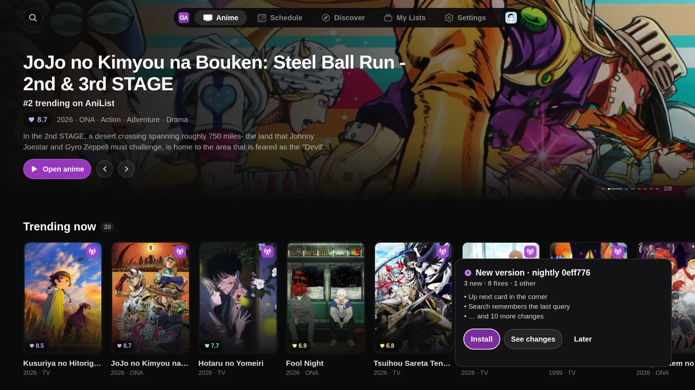
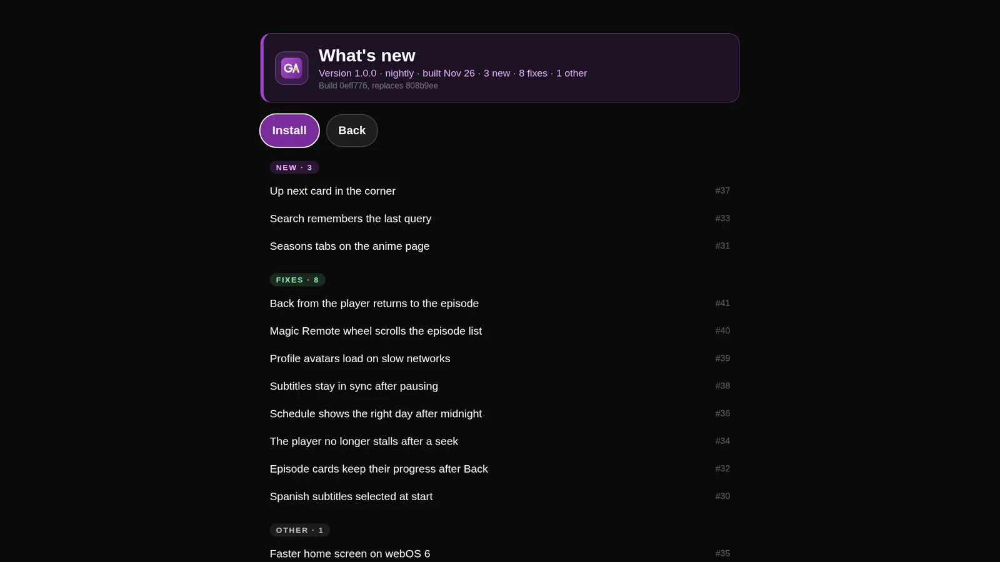
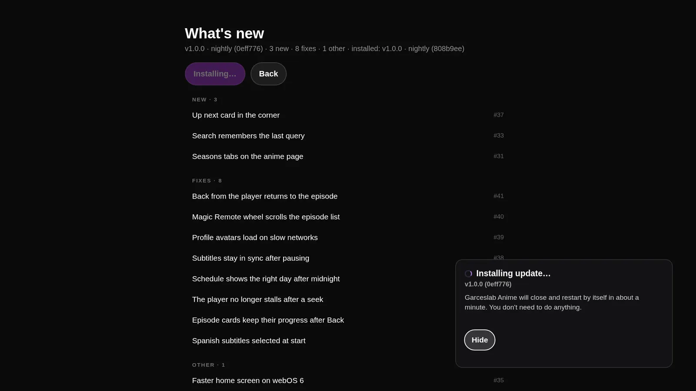

# TV updates: confirm before installing

A new build of the TV app is installed only after someone on the TV says yes. The
self-hoster's own **updater** (outside this repository, over webOS Developer Mode) follows a
release channel, downloads and checks new builds, and waits. The Garceslab Anime server
proxies the updater's status, and the TV shows a small card asking whether to install.

The TV never talks to the updater: it only calls the Garceslab server
([garceslab-anime-server#18](https://github.com/YTvictorworld/garceslab-anime-server/issues/18)).
When the server has no updater configured, the TV shows **no update UI at all**.

Only the LG webOS build shows any of this (the updater installs over webOS Developer Mode);
the Samsung Tizen build and the native apps don't.

## What you see

### The "New version" card

```
⬆ New version · nightly 0eff776
3 new · 8 fixes
• Seasons tabs on the anime page
• Spanish subtitles selected at start
• … and 9 more changes
[ Install ]  [ See changes ]  [ Later ]
```

- Bottom-right, fixed size, like the player's "Up next" card. At most three change lines,
  features first, then a counter. The changes are pull request titles from the nightly's
  `changes.json` ([releasing.md](releasing.md#release-channels)); internal ones (docs, CI,
  tests…) are never shown.
- **Once per pending build:** the card comes up a few seconds after the app opens (or after
  the server reports a new build), and this TV remembers the build so it isn't shown again.
  When several builds are waiting the updater offers only the newest, with the changes since
  the installed one.
- **Never during playback**, never over a drawer, a dialog or the on-screen keyboard.
- **Doesn't take focus while you're using the remote:** it waits until no key was pressed for
  about 2.5 seconds, then focuses **Install**. Left/Right move between its buttons; focus
  stays in the card until you choose. **Back** or **Later** closes it, and focus goes back to
  where it was. Untouched for about 12 seconds, it goes away by itself.
- **Later** only hides the card on this TV; the build is still in Settings → Updates.



### See changes

A full-screen list of the pending build's changes grouped **New**, **Fixes** and **Other**
(newest first), with **Install** and **Back** at the top. The D-pad moves line by line and
the page scrolls with it. If the updater couldn't follow every build back to the installed
one, a line says some changes may be missing.



### Install

**Install** (on the card, in See changes or in Settings) first asks to confirm: the app closes
while the update installs and opens again by itself. After **Install** the card says
**"Installing update… Garceslab Anime will close and restart by itself"**. The updater then
reinstalls the app and relaunches it, so the app disappearing mid-way is expected: losing the
server during this state is not treated as an error.

- If the updater reports a failure, the card says **"Update not installed"** with its error and
  offers **Try again**.
- If the install finished but the app wasn't relaunched, the card asks you to close and open
  the app again.
- The server refuses to install while something is playing on this TV (`409
  PLAYBACK_ACTIVE`); the card says so.

| Confirm | Installing |
|---|---|
|  |  |

### Settings → Updates

Shown only when the server has an updater configured:

| Row | What it shows |
|---|---|
| Installed | Version, channel and commit installed on the TV, and the channel the updater follows |
| Update available / Up to date | The pending build and its counts; opens See changes |
| Install update | Asks to confirm, then installs (shows "Installing…" while it runs) |
| Skip this build | Tells the updater to drop this build (`POST /later`); it isn't offered again until a newer one arrives |
| Last install | The updater's last result: "Installed v1.0.0 (abc1234) · 2 h ago" or "Failed: …" |

When the server can't reach the updater, the section shows **"Updater unreachable"** with the
server's error and a **Check again** row; no card is shown.

| Updates | Updater unreachable |
|---|---|
|  |  |

The screenshots were taken in headless Chromium at 1920×1080 against a throwaway local server
with made-up profiles and a faked updater status.

## How often the TV asks

- When the app starts, when it comes back to the foreground (if the last answer is more than
  5 minutes old), when Settings is opened, and every **30 minutes**. One small request each time.
- Every **5 seconds** only while an install runs, to notice when it ends.
- Nothing while the app is in the background.

## Server API the TV uses

All under the server's normal API envelope (`{ "data": … }`, errors as `{ "error": "…" }`),
sent like every other request (password header, profile session).

| Request | Answer (`data`) |
|---|---|
| `GET /api/v1/tv-updates/status` | `{ "configured": false }` → no update UI. `{ "configured": true, "reachable": false, "error": "…" }` → "Updater unreachable" in Settings. `{ "configured": true, "reachable": true, "status": <updater status> }` |
| `POST /api/v1/tv-updates/install` | `{ "ok": true, "result": … }`, or `ok: false` with `result.error`. `409` with `PLAYBACK_ACTIVE` while this TV plays something |
| `POST /api/v1/tv-updates/later` | Same shape |

A server without these routes (`404`) counts as "not configured".

`<updater status>` is the updater's own `GET /status`, passed through:

```json
{
  "channel": "nightly",
  "installed": { "version": "1.0.0", "commit": "<sha>", "shortCommit": "808b9ee", "channel": "nightly", "builtAt": "…" },
  "pending": {
    "version": "1.0.0", "commit": "<sha>", "shortCommit": "0eff776", "builtAt": "…", "channel": "nightly",
    "changes": [ { "type": "feat", "title": "Seasons tabs", "pr": 21, "url": "…" } ],
    "changesComplete": true
  },
  "tvOnline": true,
  "installing": false,
  "installPhase": null,
  "lastResult": { "at": "…", "ok": true, "version": "1.0.0", "commit": "<sha>", "shortCommit": "808b9ee", "error": null }
}
```

The TV reads it defensively: `installed`, `pending` and `lastResult` may be `null`, unknown
change types count as "other", `internal` changes are dropped, and anything unexpected hides
the update UI instead of showing an error. The card's "seen" build is the pending `commit`
(or version and build time for a stable build without one), stored on the TV only.

## Code

| File | What |
|---|---|
| `src/lib/tv-updates/tv-updates.ts` | Pure logic: parsing the answers, grouping and counting changes, card lines, labels, the card's visibility rules and timing, polling intervals, the install watch |
| `src/api/hooks/tv-updates.hooks.ts` | The status query, install / skip requests, the shared install state |
| `src/components/tv/tv-update-card.tsx` | The card, the install progress card, the confirmation, and the host mounted in `app/(app)/_layout.tsx` |
| `src/components/tv/tv-update-changes-screen.tsx` | "See changes" (`app/(app)/tv-update-changes.tsx`) |
| `src/components/tv/tv-settings-screen.tsx` | Settings → Updates |
| `tests/tv-updates.test.ts` | Parsing, grouping/counting/truncation, card rules (not configured, unreachable, no pending, pending, seen, during playback, installing), polling and install outcomes |

## Check on a real TV

The card's focus, Back and the restart after installing can only be checked on a TV with an
updater set up; see [testing-on-tv.md](testing-on-tv.md). Things to check:

1. With a pending build, open the app: the card comes up after a few seconds, Install focused;
   Left/Right move between buttons, Back closes it and focus returns to the home screen.
2. Close and reopen the app: the card doesn't come back for the same build.
3. Start a video: no card over the player.
4. Install → confirm: "Installing…", the app closes, reinstalls and opens again on the new
   build (Settings shows the new commit, no card).
5. Settings → Updates with the updater stopped: "Updater unreachable".
